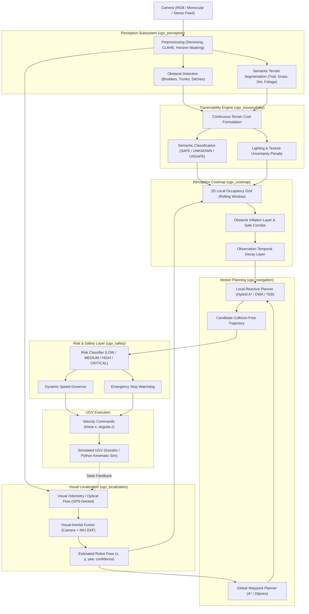

# SIH26126 — Technical Architecture Specification

**Project Title:** Vision Based Autonomous Navigation for Unmanned Ground Vehicle (UGV) for Outdoor Environment
**Hackathon Problem:** SIH26126
**System Class:** Software-Only Autonomous Ground Vehicle Navigation Stack (GPS-Denied, Camera-First)
**Architecture Reference:** Canonical Foundation Architecture (Phases 0–12). For Phase 13 Dynamic Obstacle & Predictive Navigation Architecture, see [`docs/PHASE_13_MASTER_CONTEXT.md`](PHASE_13_MASTER_CONTEXT.md) and [`docs/ROS2_RUNTIME_INTEGRATION_PLAN.md`](ROS2_RUNTIME_INTEGRATION_PLAN.md).

---

## 1. System Pipeline Architecture

The end-to-end autonomous navigation pipeline flows strictly through modular, loosely coupled stages:



---

## 2. Subsystem Descriptions & Data Contracts

### 2.1 Camera Input (`FramePacket`)
- **Input:** Single or dual RGB video frames, simulated or recorded.
- **Contract:** Synchronized image array (`uint8`, $H \times W \times 3$), timestamp, sequence ID, optional raw IMU readings.
- **Operational Requirement:** Resilient to lens glare, overexposure, harsh sunlight, and moving tree canopy shadows.

### 2.2 Perception Subsystem (`ugv_perception`)
- **Modules:**
  1. `preprocessing`: Contrast Limited Adaptive Histogram Equalization (CLAHE), bilateral edge-preserving smoothing, sky horizon detection.
  2. `detection`: Bounding-box and contour extraction for negative obstacles (ditches, ruts) and positive obstacles (rocks, stumps, posts).
  3. `segmentation`: Lightweight semantic pixel parsing.
- **Output:** Categorized obstacle lists (`ObstacleBBox`) and raw semantic masks.

### 2.3 Traversability Engine (`ugv_traversability`)
- **Responsibility:** Translates multi-cue perception into navigable ground costs.
- **Classification Categories:**
  - `SAFE (0)`: Well-worn dirt trails, flat soil, benign mowed grass.
  - `UNKNOWN (1)`: Overgrown tall grass, obscured shadows, uncharted terrain.
  - `UNSAFE (2)`: Boulders, steep ditch banks, water hazards, vertical obstacles.
- **Continuous Cost Model:**
  $$C_{\text{total}} = w_1 \cdot C_{\text{terrain}} + w_2 \cdot C_{\text{obstacle}} + w_3 \cdot U_{\text{lighting}} + w_4 \cdot (1 - L_{\text{confidence}})$$
- **Safety Invariant:** *False-safe predictions are strictly minimized*. Marking an unsafe ditch as safe is catastrophic; marking a safe path as uncertain is acceptable.

### 2.4 Visual Localization (`ugv_localization`)
- **Operating Constraint:** **Strictly zero GPS dependency**.
- **Approach:**
  - Feature-based optical flow tracking (Lucas-Kanade / FAST-ORB) tracking ground texture and distant horizon features.
  - Integration of camera motion estimates with IMU gyroscope/accelerometer via an Extended Kalman Filter (EKF).
- **Output:** Metric 2D/3D pose $(x, y, z, \theta_{\text{yaw}})$ with associated covariance and tracking health status.

### 2.5 Perception-Derived Costmap (`ugv_costmap`)
- **Grid Specifications:** Local ego-centric rolling 2D costmap ($10.0\text{ m} \times 10.0\text{ m}$ at $0.05\text{ m}$ grid cell resolution).
- **Layers:**
  1. *Traversability Layer:* Direct projection of camera traversability scores onto ground coordinates.
  2. *Inflation Layer:* Exponential decay buffer outward from all UNSAFE obstacles by $R_{\text{robot}} + \text{margin}$.
  3. *Decay Layer:* Temporal fading of stale observations to handle dynamic obstacles.

### 2.6 Motion Planning (`ugv_navigation`)
- **Global Planner:** A* / Dijkstra searching across topological waypoints or accumulated global occupancy grid.
- **Local Reactive Planner:** Hybrid A* or Dynamic Window Approach (DWA) enforcing non-holonomic Ackerman/differential kinematic constraints, steering clear of moving hazards.
- **Output:** Smooth, dynamically feasible trajectory arc $(v, \omega)$ over a 2-second lookahead window.

### 2.7 Risk & Safety Subsystem (`ugv_safety`)
- **Risk Taxonomy:**
  - `LOW RISK`: Path clearance $> 1.5\text{ m}$, traversability confidence high $\to$ Execute nominal speed ($1.0 - 1.2\text{ m/s}$).
  - `MEDIUM RISK`: Clearance $0.8 - 1.5\text{ m}$ or terrain unknown $\to$ Throttle speed by 50% ($0.5\text{ m/s}$), tighten sensor scan.
  - `HIGH RISK`: Obstacle encroaching path within $0.5\text{ m}$ $\to$ Halt linear progression, trigger local dynamic replan.
  - `CRITICAL RISK`: Immediate forward obstruction $< 0.35\text{ m}$ or visual tracking lost $\to$ Instantaneous E-Stop, zero velocity command.

---

## 3. Technology Roles & Separation of Concerns

```
+---------------------------------------------------------------------------------------+
|                                    TECHNOLOGY ROLES                                   |
+----------------------------------+----------------------------------------------------+
| Technology                       | Explicit Role in SIH26126 System                   |
+----------------------------------+----------------------------------------------------+
| Python 3.10+                     | Core algorithm development: computer vision, ML   |
| (OpenCV, PyTorch, NumPy, SciPy)  | inference, traversability scoring, costmaps,       |
|                                  | A*/DWA planning, risk models, HUD visualization.   |
+----------------------------------+----------------------------------------------------+
| Cloud GPU (NVIDIA A100)          | High-throughput model training, knowledge          |
| (Google Colab / Cloud Instances) | distillation, mixed-precision (FP16/BF16) training,|
|                                  | and automated ONNX model export.                   |
+----------------------------------+----------------------------------------------------+
| MATLAB / GNU Octave              | Offline camera calibration validation, visual      |
|                                  | odometry drift analysis, ground-truth trajectory   |
|                                  | benchmarking (ATE, RPE), and planner comparison.   |
+----------------------------------+----------------------------------------------------+
| ROS 2 (Jazzy / Humble in WSL2)   | System integration layer: sensor topics, TF2       |
|                                  | transforms, Nav2 costmap plugins, lifecycle nodes.  |
+----------------------------------+----------------------------------------------------+
| Gazebo (Harmonic / Fortress)     | Physics simulation: simulated UGV chassis, sensors |
|                                  | (camera, IMU), outdoor terrains, lighting changes.  |
+----------------------------------+----------------------------------------------------+
```

### 3.1 Python Role
Python is the core language for all custom algorithms. Modules are self-contained, typed, and executable independent of ROS 2. This guarantees rapid prototyping, deterministic testing, and ease of demonstration.

### 3.2 Cloud NVIDIA A100 Role
Deep neural networks are trained and distilled in cloud instances with A100 GPUs. The resulting models are exported to INT8/FP32 ONNX formats and transferred to the local system for edge execution.

### 3.3 MATLAB Role
MATLAB is strictly an **analytical and validation tool** (not a runtime dependency). It evaluates camera calibration intrinsics, computes trajectory drift error against known ground truth, and outputs publication-grade comparison plots.

### 3.4 ROS 2 Role
ROS 2 handles modular inter-process communication, standardized sensor message definitions (`sensor_msgs/Image`, `nav_msgs/OccupancyGrid`), TF2 coordinate frame tree management (`map -> odom -> base_link -> camera_link`), and Nav2 integration for full-system demonstration in Phase 8+.

### 3.5 Gazebo Role
Gazebo provides a repeatable, physically accurate virtual world. It hosts the 3D rover model, differential drive plugins, simulated optical sensors, bumpy terrain meshes (rocks, gravel, mud, slopes), and changing lighting conditions.
