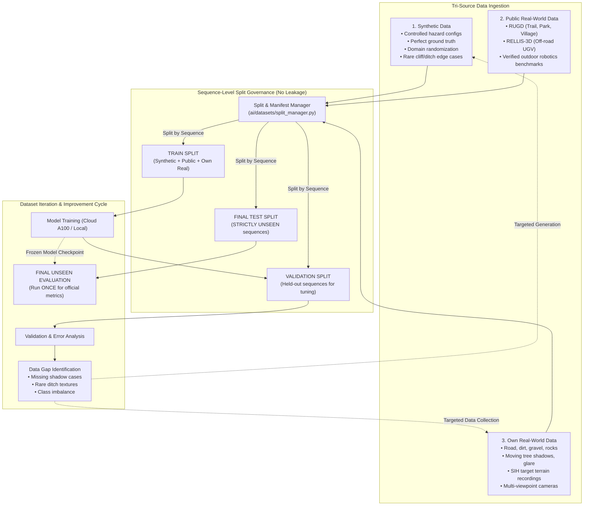

# SIH26126 — Hybrid Dataset Strategy & Governance

**System:** Autonomous UGV Navigation Stack  
**Policy Status:** **ACTIVE & ENFORCED**  
**Core Rule:** `TRAINING SEQUENCES ≠ VALIDATION SEQUENCES ≠ FINAL TEST SEQUENCES`

---

## 1. Tri-Source Hybrid Dataset Architecture

The project employs a balanced, tri-source dataset strategy to train, validate, and evaluate the vision-based traversability and obstacle detection models:



---

## 2. Tri-Source Roles & Characteristics

| Source | Role in System | Key Strengths | Specific Cautions |
| :--- | :--- | :--- | :--- |
| **1. Synthetic Data** | Baseline verification, rare hazards, domain randomization | Pixel-perfect ground truth, repeatable camera poses, arbitrary lighting/shadow angles, negative obstacle generation | Domain gap: synthetic accuracy does *not* imply real-world generalization. |
| **2. Public Real-World Data** | Broad off-road terrain features, baseline benchmarking | Diversity of environments (RUGD, RELLIS-3D), peer-reviewed benchmarks | Sensor differences (different FOV, height, lens distortion) requiring calibration alignment. |
| **3. Our Own Real-World Data** | Domain adaptation, mission-specific terrain, target validation | Exact camera hardware, authentic local lighting conditions, actual chassis vibration, genuine terrain mix | Must be explicitly separated at the sequence level to prevent leakage. |

---

## 3. Strict Data Leakage Prevention

### 3.1 The Sequence-Level Invariant
- **Frame-Level Leakage is STRICTLY PROHIBITED:** Adjacent frames in a continuous video stream share $>98\%$ visual similarity. Splitting adjacent frames across Train and Test produces false benchmark scores ($>99\%$ accuracy) that collapse during physical deployment.
- **Enforcement:** Data splitting is performed **exclusively at the sequence / video level**:
  $$\text{Sequences}(\text{Train}) \cap \text{Sequences}(\text{Val}) = \emptyset$$
  $$\text{Sequences}(\text{Train}) \cap \text{Sequences}(\text{Test}) = \emptyset$$
  $$\text{Sequences}(\text{Val}) \cap \text{Sequences}(\text{Test}) = \emptyset$$

### 3.2 Concrete Example
```
video_001_dirt_trail.mp4    ──>  TRAIN
video_002_rock_path.mp4     ──>  TRAIN
video_003_sunny_grass.mp4   ──>  VALIDATION
video_004_mixed_shadows.mp4 ──>  FINAL TEST (HELD OUT)
```
No frames from `video_004` may ever be fed into training, loss calculation, or hyperparameter optimization.

---

## 4. Own Data Ingestion Protocol

Own real-world recordings can contribute to **Training, Validation, and Final Testing**, provided they follow this ingestion protocol:
1. **Raw Ingestion (`data/raw/own_data/`):** Video files or image bursts are stored in sequence-specific folders (`sequence_YYYYMMDD_loc_NNN/`).
2. **Metadata Manifesting:** Every sequence is logged with:
   - Environment type (`dirt`, `gravel`, `grass`, `rocks`, `mixed`)
   - Lighting conditions (`bright_sun`, `overcast`, `heavy_shadows`, `glare`)
   - Camera parameters (sensor model, resolution, FPS)
   - Assigned split (`train`, `val`, or `test`)
3. **Annotation Mapping:** Keyframes are annotated with the project's standard 3-class traversability labels:
   - `0: SAFE` (flat trail, smooth dirt, benign grass)
   - `1: UNKNOWN` (tall brush, obscured shadows, uncharted terrain)
   - `2: UNSAFE` (boulders, ditches, water bodies, tree trunks)

---

## 5. Dataset Iteration & Gap Analysis Cycle

Rather than blindly increasing dataset volume, the project follows an iterative diagnostic loop:
```
DATA ──> AUDIT ──> BASELINE MODEL ──> ERROR ANALYSIS ──> IDENTIFY GAPS ──> TARGETED DATA ──> RETRAIN
```

### Failure Diagnosis Categories
When the vision model misclassifies terrain, we categorize the root cause:
1. **Domain Gap:** Model trained on sunny synthetic trails fails on real gravel under cloudy skies $\to$ Inject real cloudy sequences.
2. **Missing Training Data:** Model encounters mud/ditches never seen in training $\to$ Collect or synthesize dedicated ditch scenarios.
3. **Incorrect Labels:** Ambiguous transition zones between path and foliage $\to$ Refine labeling guidelines.
4. **Model Failure:** Backbone capacity too low or receptive field too small $\to$ Adjust network architecture or attention heads.

---

## 6. Final Test Policy

1. **Strictly Untouched:** The final test set remains completely frozen during development and model exploration.
2. **Evaluation Execution:** The final test benchmark is executed only once (or during formal milestone evaluations).
3. **Version Control:** If the test set must be updated or expanded, it is versioned (`test_v1`, `test_v2`) and the changes are explicitly recorded in documentation.
