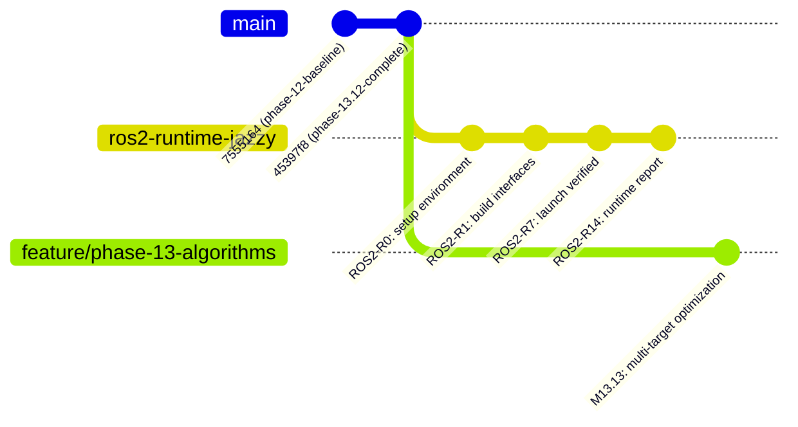

# ROS 2 JAZZY & GAZEBO HARMONIC RUNTIME INTEGRATION PLAN
## Dynamic Obstacle Navigation Stack — Pre-Push Integration Specification

**Document File:** `docs/ROS2_RUNTIME_INTEGRATION_PLAN.md`
**Target System:** ROS 2 Jazzy Jalisco on Ubuntu 24.04 LTS (x86_64)
**Simulation Target:** Gazebo Harmonic (ros_gz bridge)
**Implementation Baseline Commit:** `45397f8`
**Implementation Baseline Tag:** `phase-13.12-complete`
**Master Context Reference:** `docs/PHASE_13_MASTER_CONTEXT.md`
**Audience:** ROS 2 Integration & Simulation Engineer / Teammate

---

## 1. Executive Summary & Objective

This document defines the **practical, gated runtime integration plan** for taking the existing Phase 13.12 autonomous UGV navigation stack from its verified in-memory/test-double architecture to full native execution under **ROS 2 Jazzy Jalisco** and **Gazebo Harmonic** on Ubuntu 24.04.

### What Has Already Been Built & Verified
The entire algorithmic and architectural pipeline is implemented, frozen, and verified by **461 automated tests (100% pass rate)**:
- **13 Canonical ROSIDL Interface Specifications:** Defined in `ros2_ws/src/ugv_navigation_msgs/msg/*.msg`.
- **Bidirectional Conversion Boundary:** Encapsulated in `ros2_ws/src/ugv_navigation/ugv_navigation/converters/dynamic_converters.py` with zero ROS imports in algorithmic modules.
- **7 Dynamic ROS 2 Application Nodes:** Structured under `ros2_ws/src/ugv_navigation/ugv_navigation/nodes/`.
- **Node Communication Graph & Canonical Topics:** Verified against `ros2_ws/src/ugv_navigation/config/qos_profiles.yaml` and `ugv_params.yaml`.
- **Launch File Pipeline:** Defined in `ros2_ws/src/ugv_navigation/launch/dynamic_navigation.launch.py`.
- **Pure Mathematical Core:** Tracking (Hungarian + Kalman), Prediction (linear/turn rate extrapolation), Dynamic Occupancy (spatio-temporal slices), Predictive DWA, Behavioral State Machine, and Event-Driven Replanning are fully implemented in `ai/planning/dynamic/*`.

### Current Verification Status: Unverified on Native ROS 2 Host
Because the primary development host is Windows without a native ROS 2 toolchain, **all ROS 2 verification to date has been performed via structural test doubles, contract validation, and headless SIL adapters**.

> [!IMPORTANT]
> **Your Role as the ROS 2 Teammate:**
> You are responsible for **BUILD, RUNTIME, INTEGRATION, SIMULATION, PERFORMANCE PROFILING, and EVIDENCE COLLECTION** on a native Linux (Ubuntu 24.04 / ROS 2 Jazzy) system.
> You do **NOT** need to redesign, reimplement, or alter the underlying mathematical algorithms.

---

## 2. Ownership Separation & Architectural Boundaries

To preserve architectural integrity and prevent regressions across the verified codebase, strict domain boundaries are established between the **Algorithmic Core** and the **ROS 2 / Runtime Integration**:

```
+-----------------------------------------------------------------------------------+
|                            ALGORITHMIC CORE (FROZEN)                              |
|                    Maintained by Algorithm Development Lead                       |
+-----------------------------------------------------------------------------------+
|  - Computer vision & semantic traversability     - Kalman tracking (CV / CT)      |
|  - Spatial fusion & WorldTerrainMap engine       - Motion prediction models       |
|  - Time-parameterized dynamic occupancy grids    - Predictive collision checking  |
|  - Dynamic Window Approach (DWA) scoring         - Behavioral State Machine       |
|  - Event-driven global replanning (A*) logic     - Emergency safety clamps        |
|  - pure mathematical data structures in ai/planning/dynamic/*                     |
+-----------------------------------------------------------------------------------+
                                         │
                   Bidirectional Converter Boundary
            (ros2_ws/src/ugv_navigation/ugv_navigation/converters/)
                                         │
+-----------------------------------------------------------------------------------+
|                         ROS 2 / RUNTIME INTEGRATION                               |
|                         Owned by ROS 2 Teammate                                   |
+-----------------------------------------------------------------------------------+
|  - colcon build environment & toolchain setup    - ROSIDL C/Python code generation|
|  - Native rclpy node execution & lifecycle       - Real DDS message transport     |
|  - QoS profile enforcement & validation          - Dynamic TF2 coordinate trees   |
|  - Launch file orchestration & parameter binding - Gazebo Harmonic simulation     |
|  - ros_gz parameter bridges & sensor feeds       - /cmd_vel closed-loop control   |
|  - Dynamic obstacle scenario validation          - Runtime telemetry & profiling  |
|  - docs/ROS2_RUNTIME_VALIDATION_REPORT.md        - Video/screenshot logs          |
+-----------------------------------------------------------------------------------+
```

### Permitted Modifications for ROS 2 Teammate
The ROS 2 teammate **IS AUTHORIZED** to modify or create:
1. `ros2_ws/src/ugv_navigation/package.xml` and `CMakeLists.txt` / `setup.py` build configuration.
2. `ros2_ws/src/ugv_navigation_msgs/package.xml` and `CMakeLists.txt`.
3. Launch files in `ros2_ws/src/ugv_navigation/launch/` and `simulation/launch/`.
4. System and node parameter YAML files in `ros2_ws/src/ugv_navigation/config/`.
5. Robot description files (URDF, Xacro, SDF) in `simulation/models/`.
6. Gazebo world files and physics configurations in `simulation/worlds/`.
7. `ros_gz` bridge configuration files (e.g., `simulation/config/bridge_params.yaml`).
8. ROS 2 runtime integration test scripts under `tests/` specifically asserting native DDS behavior.
9. Runtime documentation and forensic reports (`docs/ROS2_RUNTIME_VALIDATION_REPORT.md`).

### Prohibited Modifications Without Prior Architecture Review
The ROS 2 teammate **MUST NOT MODIFY**:
- `ai/planning/dynamic/*` (all core mathematical and algorithmic models).
- `ai/spatial_fusion/*`, `ai/costmap/*`, `ai/planning/*` (Phase 4–12 foundational algorithms).
- Canonical `.msg` field names, data types, or definitions in `ugv_navigation_msgs/msg/*.msg`.
- Canonical topic naming strings or established topic contracts.
- Safety-critical thresholds: Emergency stop distance ($0.35\,\text{m}$), safety clamp distance ($0.60\,\text{m}$), vehicle footprint ($0.90\,\text{m} \times 0.65\,\text{m}$).
- Kinematic velocity limits ($v_{\max} = 0.6\,\text{m/s}$, $\omega_{\max} = 0.8\,\text{rad/s}$).

> [!CAUTION]
> If a runtime interface incompatibility is discovered, **document the exact discrepancy first** in an issue or report before attempting to alter shared architecture.

---

## 3. Recommended Branching & Collaboration Workflow

### Baseline Checkpoints
- **Baseline Git Commit:** `45397f8`
- **Baseline Git Tag:** `phase-13.12-complete`
- **Working Tree Rule:** The implementation baseline commit is frozen. The pre-push documentation updates reside on top of this commit.

### Branch Structure


1. **Checkout Baseline:**
   ```bash
   git fetch origin
   git checkout -b feature/ros2-runtime-jazzy phase-13.12-complete
   ```
2. **Execute Gated Milestones:** Step through Gates **ROS2-R0** through **ROS2-R14** sequentially.
3. **Commit Disciplined Artifacts:** Commit working configuration, launch files, and test logs incrementally.
4. **Deliverables Required for Merge:**
   - Passing native build and runtime test logs.
   - Gazebo simulation recordings/screenshots showing closed-loop obstacle avoidance.
   - Completed `docs/ROS2_RUNTIME_VALIDATION_REPORT.md` (Gate ROS2-R14).

---

## 4. Gated Runtime Integration Sequence (ROS2-R0 to ROS2-R14)

Every gate has explicit **Prerequisites**, **Execution Commands**, and **Pass/Fail Acceptance Criteria**. You must satisfy each gate before proceeding to the next.

---

### Gate ROS2-R0 — Target Environment & Toolchain Setup
- **Objective:** Provision a clean, reproducible Linux host environment for ROS 2 Jazzy Jalisco.
- **System Requirements:**
  - OS: **Ubuntu 24.04 LTS (Noble Numbat)**
  - ROS 2: **Jazzy Jalisco (`ros-jazzy-desktop-full`)**
  - Python: **Python 3.12+**
  - Simulation: **Gazebo Harmonic (`gz-harmonic` / `ros-jazzy-ros-gz`)**
  - Middleware: **CycloneDDS (`ros-jazzy-rmw-cyclonedds-cpp`)** or **FastDDS**
- **Verification Commands:**
  ```bash
  # 1. Verify OS and ROS 2 distribution
  lsb_release -a
  echo $ROS_DISTRO   # Must output: jazzy

  # 2. Verify Gazebo Harmonic
  gz sim --version   # Must output: Gazebo Sim, version 8.x (Harmonic)

  # 3. Verify Python environment and dependencies
  python3 --version  # Must output: Python 3.12.x
  python3 -c "import numpy, scipy, torch; print('Python Scientific Stack OK')"

  # 4. Install build dependencies
  sudo apt-get update && sudo apt-get install -y \
    python3-colcon-common-extensions \
    python3-rosdep \
    ros-jazzy-ros-gz \
    ros-jazzy-tf2-tools \
    ros-jazzy-rmw-cyclonedds-cpp
  ```
- **Exit Criteria:** All commands execute cleanly with zero missing library warnings.

---

### Gate ROS2-R1 — Interface Package Build (`ugv_navigation_msgs`)
- **Objective:** Compile the standalone `ament_cmake` interface package and generate native ROSIDL C++ and Python bindings for all 13 custom messages.
- **Execution Commands:**
  ```bash
  cd ~/SIH2026/ros2_ws
  colcon build --packages-select ugv_navigation_msgs --symlink-install
  source install/setup.bash

  # Verify interface discovery
  ros2 interface package ugv_navigation_msgs
  ```
- **Verification Checklist (All 13 Messages Must Be Listed):**
  - [ ] `ugv_navigation_msgs/msg/BehavioralDecision`
  - [ ] `ugv_navigation_msgs/msg/DynamicObstacleDetection`
  - [ ] `ugv_navigation_msgs/msg/DynamicObstacleDetectionArray`
  - [ ] `ugv_navigation_msgs/msg/DynamicOccupancyGridSlice`
  - [ ] `ugv_navigation_msgs/msg/DynamicOccupancySliceArray`
  - [ ] `ugv_navigation_msgs/msg/DynamicReplanEvent`
  - [ ] `ugv_navigation_msgs/msg/LocalizationStatus`
  - [ ] `ugv_navigation_msgs/msg/PredictedObstacleTrajectory`
  - [ ] `ugv_navigation_msgs/msg/PredictedTrajectoryArray`
  - [ ] `ugv_navigation_msgs/msg/TrackedObstacle`
  - [ ] `ugv_navigation_msgs/msg/TrackedObstacleArray`
  - [ ] `ugv_navigation_msgs/msg/TrajectoryWaypoint`
  - [ ] `ugv_navigation_msgs/msg/WorldTerrainMap`

- **Python Import Verification:**
  ```bash
  python3 -c "from ugv_navigation_msgs.msg import TrackedObstacleArray, BehavioralDecision, DynamicReplanEvent; print('ROSIDL Python Imports OK')"
  ```
- **Exit Criteria:** `colcon build` succeeds with 0 errors; all 13 interfaces are queryable via `ros2 interface show`; Python imports resolve directly from the built `install/` space.

---

### Gate ROS2-R2 — Application Package Build (`ugv_navigation`)
- **Objective:** Build the `ament_python` application package and verify console script entry points.
- **Execution Commands:**
  ```bash
  cd ~/SIH2026/ros2_ws
  colcon build --packages-select ugv_navigation --symlink-install
  source install/setup.bash

  # Verify package discovery
  ros2 pkg executables ugv_navigation
  ```
- **Verification Checklist (All 13 Console Scripts Must Be Discoverable):**
  - [ ] `replay_node`
  - [ ] `perception_node`
  - [ ] `localization_node`
  - [ ] `spatial_fusion_node`
  - [ ] `static_tf_node`
  - [ ] `planner_node`
  - [ ] `dynamic_detector_node`
  - [ ] `dynamic_tracker_node`
  - [ ] `dynamic_predictor_node`
  - [ ] `dynamic_occupancy_node`
  - [ ] `dynamic_planner_node`
  - [ ] `behavioral_state_node`
  - [ ] `global_replanner_node`

- **Import Purity Verification:**
  Verify that `NATIVE_ROSIDL_AVAILABLE` evaluates to `True` inside `ugv_navigation` without falling back to mock dataclasses:
  ```bash
  python3 -c "from ugv_navigation.converters.dynamic_converters import ROSIDL_UGV_MSGS_AVAILABLE; assert ROSIDL_UGV_MSGS_AVAILABLE, 'ROSIDL unavailable'; print('Production Converter Binding Parity Confirmed')"
  ```
- **Exit Criteria:** Zero build warnings; all 13 executables registered in `ament_index`; `ROSIDL_UGV_MSGS_AVAILABLE is True`.

---

### Gate ROS2-R3 — Individual Node Startup & Parameter Binding
- **Objective:** Verify that every dynamic navigation node starts cleanly in a native `rclpy` runtime environment, loads parameters, and shuts down gracefully without exceptions.
- **Procedure:** Execute each node individually with `--ros-args --params-file src/ugv_navigation/config/ugv_params.yaml`:
  1. `dynamic_detector_node`
  2. `dynamic_tracker_node`
  3. `dynamic_predictor_node`
  4. `dynamic_occupancy_node`
  5. `dynamic_planner_node`
  6. `behavioral_state_node` (standalone mode test)
  7. `global_replanner_node` (standalone mode test)
- **Validation Commands (Example for Tracker):**
  ```bash
  ros2 run ugv_navigation dynamic_tracker_node --ros-args --params-file src/ugv_navigation/config/ugv_params.yaml &
  PID=$!
  sleep 2
  ros2 node info /dynamic_tracker_node
  ros2 param get /dynamic_tracker_node tracking_frame
  kill -SIGINT $PID
  ```
- **Exit Criteria:** Each node logs initialization successfully, advertises its canonical subscriptions/publishers, responds to `ros2 param get`, and terminates cleanly on SIGINT with exit code 0.

---

### Gate ROS2-R4 — Native DDS Pub/Sub Communication Pipeline
- **Objective:** Verify genuine inter-process DDS communication across the perception-to-planning pipeline.
- **Pipeline Chain to Test:**
  $$\text{Detector} \xrightarrow{\text{/perception/dynamic_obstacles}} \text{Tracker} \xrightarrow{\text{/tracking/dynamic_obstacles}} \text{Predictor} \xrightarrow{\text{/prediction/obstacle_trajectories}} \text{Occupancy} \xrightarrow{\text{/occupancy/dynamic_slices}} \text{Planner}$$
- **Verification Steps:**
  1. Start `dynamic_detector_node`, `dynamic_tracker_node`, `dynamic_predictor_node`, `dynamic_occupancy_node`, and `dynamic_planner_node`.
  2. Publish a synthetic test detection message to `/perception/dynamic_obstacles` using `ros2 topic pub --once`.
  3. Observe downstream topics using `ros2 topic echo`:
     - `/tracking/dynamic_obstacles` receives confirmed track message with populated track ID.
     - `/prediction/obstacle_trajectories` receives predicted waypoints over horizon $H = 2.0\,\text{s}$.
     - `/occupancy/dynamic_slices` receives multi-slice occupancy grids.
- **Exit Criteria:** Zero deserialization errors, zero schema dropouts, correct sequence counters, and timestamps advancing monotonically.

---

### Gate ROS2-R5 — QoS Profile & Contract Enforcement
- **Objective:** Verify runtime QoS compatibility against `ros2_ws/src/ugv_navigation/config/qos_profiles.yaml`.
- **Requirements Matrix:**

| Topic | Expected Reliability | Expected Durability | Expected Depth |
|---|---|---|---|
| `/perception/dynamic_obstacles` | Best Effort | Volatile | 10 |
| `/tracking/dynamic_obstacles` | Best Effort | Volatile | 10 |
| `/prediction/obstacle_trajectories` | Best Effort | Volatile | 5 |
| `/occupancy/dynamic_slices` | Best Effort | Volatile | 5 |
| `/behavior/tactical_decision` | Reliable | Volatile | 10 |
| `/planning/dynamic_replan_event` | Reliable | Volatile | 10 |
| `/cmd_vel` | Reliable | Volatile | 1 |
| `/planning/global_path` | Reliable | Volatile | 10 |
| `/planning/dynamic_trajectory` | Best Effort | Volatile | 1 |

- **Verification Command:**
  ```bash
  ros2 topic info /tracking/dynamic_obstacles --verbose
  ros2 topic info /planning/dynamic_replan_event --verbose
  ```
- **Exit Criteria:** Publisher and subscriber QoS profiles match with zero incompatible QoS warnings logged in `dmesg` or `rclpy`.

---

### Gate ROS2-R6 — TF2 Coordinate Frame Tree Parity
- **Objective:** Verify the canonical TF2 coordinate tree and validate sub-millisecond lookup latency.
- **Tree Topology:**
  $$\text{odom} \xrightarrow[\text{LocalizationNode}]{\text{dynamic}} \text{base_link} \xrightarrow[\text{StaticTfNode}]{\text{static}} \text{camera_link} \xrightarrow[\text{StaticTfNode}]{\text{static}} \text{camera_optical}$$
- **Verification Commands:**
  ```bash
  ros2 run tf2_tools view_frames
  # Inspect generated frames.pdf

  ros2 run tf2_ros tf2_echo odom base_link
  ros2 run tf2_ros tf2_echo base_link camera_optical
  ```
- **Exit Criteria:**
  - `frames.pdf` contains a single connected tree rooted at `odom`.
  - Transform lookups between `camera_optical` and `odom` succeed without timeout.
  - Zero extrapolation errors into the past or future.

---

### Gate ROS2-R7 — Full Launch Pipeline Execution
- **Objective:** Verify full-system startup via the canonical launch orchestrator.
- **Execution Command:**
  ```bash
  ros2 launch ugv_navigation dynamic_navigation.launch.py use_sim_time:=false
  ```
- **Verification Assertions:**
  1. `ros2 node list` outputs exactly 8 active nodes:
     - `/static_tf_node`
     - `/localization_node`
     - `/spatial_fusion_node`
     - `/dynamic_detector_node`
     - `/dynamic_tracker_node`
     - `/dynamic_predictor_node`
     - `/dynamic_occupancy_node`
     - `/dynamic_planner_node`
  2. **Single Publisher Rule Confirmed at Runtime:**
     - `ros2 topic info /cmd_vel` shows **Publisher count: 1** (`/dynamic_planner_node`).
     - `ros2 topic info /planning/dynamic_replan_event` shows **Publisher count: 1** (`/dynamic_planner_node`).
  3. `global_replanner_node` and `behavioral_state_node` are **not launched**, confirming launch-level isolation against duplicate publishers.
- **Exit Criteria:** Entire pipeline starts without exceptions; CPU consumption stable; node graph clean.

---

### Gate ROS2-R8 — Gazebo Harmonic & ros_gz Bridge Integration
- **Objective:** Launch the 4WD UGV in Gazebo Harmonic with physical camera, IMU, and differential drive actuators bridged to ROS 2.
- **Execution Commands:**
  ```bash
  # Launch Gazebo simulation with ros_gz parameter bridge
  ros2 launch simulation ugv_simulation.launch.py headless:=false
  ```
- **Verification Checklist:**
  - [ ] Gazebo Harmonic starts with world `simulation/worlds/outdoor_terrain.sdf`.
  - [ ] 4WD UGV model spawns at origin without physics explosion or tipping.
  - [ ] Camera publishes to `/camera/image_raw` at $\ge 15\,\text{Hz}$ (`ros2 topic hz /camera/image_raw`).
  - [ ] IMU publishes to `/imu/data` at $\ge 50\,\text{Hz}$ (`ros2 topic hz /imu/data`).
  - [ ] Simulated clock is active: `ros2 topic hz /clock` shows steady publication.
  - [ ] Manual teleop test: `ros2 topic pub /cmd_vel geometry_msgs/msg/Twist "{linear: {x: 0.3}}"` causes UGV to move forward in Gazebo world.
- **Exit Criteria:** UGV responds to velocity commands; sensor streams match `bridge_params.yaml` specifications.

---

### Gate ROS2-R9 — Closed-Loop Autonomous Navigation Under Simulation
- **Objective:** Connect the complete perception-planning pipeline to the simulated Gazebo robot in a closed feedback loop.
- **Data Flow:**
  $$\text{Gazebo Camera} \to \text{Perception} \to \text{Tracking} \to \text{Prediction} \to \text{DWA Planner} \to \text{/cmd_vel} \to \text{Gazebo Actuators} \to \text{Odometry Feedback}$$
- **Execution Command:**
  ```bash
  ros2 launch simulation ugv_simulation.launch.py &
  ros2 launch ugv_navigation dynamic_navigation.launch.py use_sim_time:=true
  ```
- **Test Procedure:** Send a forward goal 10 meters ahead:
  ```bash
  ros2 topic pub --once /goal_pose geometry_msgs/msg/PoseStamped "{header: {frame_id: 'odom'}, pose: {position: {x: 10.0, y: 0.0, z: 0.0}}}"
  ```
- **Exit Criteria:** UGV smoothly accelerates, tracks global path, navigates terrain, decelerates, and stops within $0.25\,\text{m}$ of target goal pose without human intervention.

---

### Gate ROS2-R10 — Standardized Dynamic Scenarios Validation
- **Objective:** Evaluate the 9 canonical Phase 13 dynamic obstacle scenarios in Gazebo Harmonic with moving obstacle actors.
- **Scenario Execution Matrix:**

| Scenario | Description | Expected Behavioral State | Expected System Outcome |
|---|---|---|---|
| **A. Static Clear Path** | No moving obstacles | `PROCEED` | UGV advances at nominal $v \approx 0.5\,\text{m/s}$ to goal |
| **B. Crossing Obstacle** | Obstacle crosses path perpendicularly 5m ahead | `AVOID` or `WAIT` | DWA steers around rear or yields; zero collisions |
| **C. Impending Collision** | Dynamic actor accelerates directly toward UGV | `STOP` | Speed clamped to $v=0.0\,\text{m/s}$ when distance $< 0.35\,\text{m}$ |
| **D. Temporary Blockage** | Obstacle pauses in corridor for $1.0\,\text{s}$ | `WAIT` | UGV holds position; resumes when corridor clears |
| **E. Persistent Blockage** | Obstacle stops in corridor $> 2.0\,\text{s}$ | `STOP` $\to$ Replan | Triggers `PERSISTENT_BLOCKAGE` on `/planning/dynamic_replan_event`, generates new $A^*$ path |
| **F. Unknown Horizon** | Prediction uncertainty grows rapidly | `AVOID` (Conservative) | Trajectory maintains generous clearance buffer |
| **G. Stale Data Rejection** | Obstacle stream stops publishing | Fallback | Planner switches to degraded mode, clears dynamic costs safely |
| **H. Malformed Message** | Corrupted inputs injected on tracking topic | Handled Gracefully | Node logs warning, drops packet, does not crash |
| **I. Multiple Moving Actors** | Two crossing obstacles simultaneously | Multi-track arbitration | Both tracks preserved; safe path selected |

- **Exit Criteria:** 9/9 scenarios pass with zero collisions and verified behavioral state transitions.

---

### Gate ROS2-R11 — Safety Supervisor & Fail-Safe Verification
- **Objective:** Validate fail-safe and watchdog behaviors when simulated components fail or enter fault states.
- **Tests to Execute:**
  1. **Emergency Hard Stop ($d < 0.35\,\text{m}$):** Inject obstacle at $0.25\,\text{m}$ $\to$ `/cmd_vel` strictly outputs $v=0.0\,\text{m/s}, \omega=0.0\,\text{rad/s}$.
  2. **Speed Clamping ($0.35\,\text{m} \le d < 0.60\,\text{m}$):** Forward velocity capped at $0.20\,\text{m/s}$.
  3. **Localization Watchdog:** Inject `tracking_state: LOST` into `/localization/status` $\to$ Planner immediately halts UGV and sets status to `LOCALIZATION_INVALID`.
  4. **Command Timeout Watchdog:** Terminate `dynamic_planner_node` abruptly $\to$ UGV motion controller must zero motors within $0.5\,\text{s}$ of lost `/cmd_vel`.
- **Exit Criteria:** UGV never moves under lost localization or killed planner; velocity clamp strictly enforced.

---

### Gate ROS2-R12 — Runtime Performance Profiling & Bottlenecks
- **Objective:** Characterize runtime resource consumption, node frequencies, and latency bottlenecks honestly.
- **Metrics to Record:**
  - **Node Startup Time:** Total duration from launch command to ready state.
  - **Dynamic Tracking Cycle Latency:** Target $< 15\,\text{ms}$.
  - **Motion Prediction Latency:** Target $< 10\,\text{ms}$.
  - **Dynamic Occupancy Slice Generation:** Target $< 20\,\text{ms}$.
  - **Local Planner (Predictive DWA) Evaluation Latency:**
    > [!NOTE]
    > **Known Limitation to Document:** The pure Python implementation of DWA evaluates candidate trajectories across multiple time-horizons in interpreted Python loops. As documented in `docs/PHASE_13_MASTER_CONTEXT.md` Section 3, pure Python DWA latency in full evaluation ranges between **$1.36\,\text{s}$ and $4.5\,\text{s}$ per cycle** on single-threaded CPU. Document this latency honestly in the report; do not artificially truncate candidate counts to forge a real-time number.
  - **Simulation Real-Time Factor (RTF):** Target $\ge 0.85$ in headless mode.
  - **System Resource Utilization:** Peak CPU % and RSS Memory per node.
- **Exit Criteria:** All latency metrics recorded and tabulated in validation report.

---

### Gate ROS2-R13 — Forensic Evidence Collection
- **Objective:** Assemble verifiable visual and textual evidence of the working integration.
- **Evidence Checklist:**
  - [ ] Terminal log capture of full build (`colcon build --event-handlers console_direct+`).
  - [ ] `ros2 node list` and `ros2 topic list` snapshots.
  - [ ] `ros2 topic hz` and `ros2 topic info --verbose` outputs for all canonical topics.
  - [ ] `frames.pdf` TF2 coordinate frame tree diagram.
  - [ ] Minimum 3 Gazebo simulation screenshots:
    1. Normal forward traversal (`PROCEED`).
    2. Tactical obstacle detour (`AVOID`).
    3. Emergency yield/stop (`STOP` or `WAIT`).
  - [ ] Screen recording or video clip showing closed-loop dynamic obstacle avoidance in Gazebo.
  - [ ] `dynamic_replan_event` capture demonstrating successful $A^*$ detour around a persistent blockage.
- **Exit Criteria:** All artifacts saved under `docs/evidence/ros2_runtime/`.

---

### Gate ROS2-R14 — Final Runtime Validation Report
- **Objective:** Produce the definitive post-integration report.
- **Deliverable File:** `docs/ROS2_RUNTIME_VALIDATION_REPORT.md`
- **Report Template & Mandatory Sections:**
  1. **Executive Summary:** Pass/Fail outcome across Gates R0–R13.
  2. **Environment Specification:** Exact Ubuntu kernel version, ROS 2 Jazzy build hash, Gazebo Harmonic version, and RMW implementation used.
  3. **Compilation & Packaging Audit:** colcon build timing, interface discovery table.
  4. **Node Graph & Topic Audit:** Actual node list, topic list, QoS match table.
  5. **TF2 Coordinate Tree Audit:** Frame tree confirmation with parent/child links and max latency.
  6. **Scenario Results Table:** Pass/Fail status for all 9 dynamic obstacle scenarios with observed clearances and latencies.
  7. **Safety & Watchdog Verification:** Verification of emergency stops, speed clamps, and heartbeat watchdogs.
  8. **Performance Characterization:** Empirical latency table (Tracker, Predictor, Occupancy, DWA, Replanner, RTF).
  9. **Defects & Anomalies Found:** Any discovered discrepancies between pure Python SIL and native ROS 2 behavior.
  10. **Final Handoff Verdict:** Signed off for Phase 14 outdoor testing integration.

---

## 5. Summary Quick-Reference Checklist for Teammate

```
[ ] ROS2-R0:  Ubuntu 24.04 + ROS 2 Jazzy + Gazebo Harmonic ready
[ ] ROS2-R1:  colcon build ugv_navigation_msgs (13 interfaces verified)
[ ] ROS2-R2:  colcon build ugv_navigation (13 console scripts registered)
[ ] ROS2-R3:  All 7 dynamic nodes start natively with rclpy
[ ] ROS2-R4:  DDS pub/sub verified end-to-end across topics
[ ] ROS2-R5:  QoS profiles match qos_profiles.yaml
[ ] ROS2-R6:  TF2 tree verified (odom -> base_link -> camera_link -> camera_optical)
[ ] ROS2-R7:  dynamic_navigation.launch.py executes cleanly (single publisher enforced)
[ ] ROS2-R8:  Gazebo Harmonic spawns UGV + ros_gz bridge operational
[ ] ROS2-R9:  Closed-loop autonomous navigation verified in simulation
[ ] ROS2-R10: 9 dynamic obstacle scenarios evaluated with zero collisions
[ ] ROS2-R11: Emergency stop (0.35m) and speed clamp (0.60m) verified
[ ] ROS2-R12: Real-time latency and resource metrics profiled
[ ] ROS2-R13: Terminal logs, TF tree PDF, and Gazebo videos collected
[ ] ROS2-R14: docs/ROS2_RUNTIME_VALIDATION_REPORT.md completed and signed off
```
